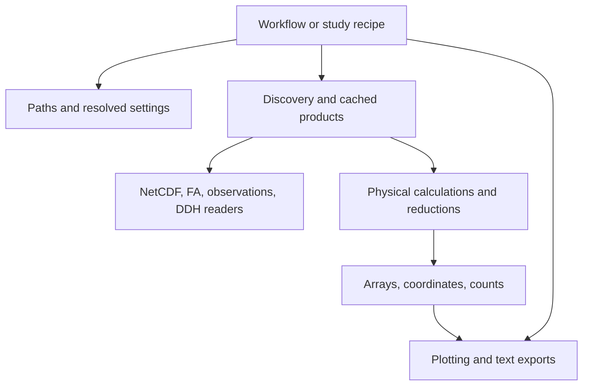

# Architecture and extension guide

An executable selects inputs and runs stages. Reusable code lives outside the
executable, so changing a figure or importing a reader does not require loading
another workflow's parser, defaults, and optional FA libraries.

Temperature and hydrometeor commands expose preparation, job construction,
computation, scale selection, and rendering as separate functions. Extended
DDH-related diagnostics additionally separate vertical coordinates and derived
precipitation ratios. Surface, radiation, pair, convective-feedback,
microphysics-budget, and updraft-hydrometeor commands import their scientific
calculations and figures from dedicated modules.

`analysis/` includes both pure equations and streaming reducers that call data
readers. The boundary enforced by tests is that reusable modules in `common/`,
`analysis/`, `data/`, `dsd/`, and `plotting/` cannot import `workflows/` or
`recipes/`. Existing DDH plot modules still provide historical command paths;
new numerical work belongs in `ddh/layer_metrics.py` or a corresponding data
module, not in a figure command.

## Follow a product

- Temperature or hydrometeor: `workflows/temperature.py` or `hydrometeor.py` →
  `data/profile_products.py` → `analysis/profiles.py` and `data/dataset_io.py`.
- Derived updrafts: `data/profile_fields.py` → `analysis/updrafts.py`.
- DSD: `workflows/dsd_*.py` → `dsd/` for the selected sampling population →
  `data/cfad_cache.py` and `plotting/dsd_cfad.py` / `dsd_gridcell.py`.
- Strong-updraft paper profiles: immutable `common/study_specs.py` →
  `data/strong_updraft_profiles.py` → `plotting/strong_updraft_profiles.py`.
- IOP rainfall: recipes → `data/iop_precipitation.py` →
  `plotting/iop_precipitation.py`.
- DDH warm-layer diagnostics: `ddh/aggregate_budgets.py` →
  `ddh/layer_metrics.py` → the DDH figure commands.

## Add an analysis

1. Describe its inputs, dimensions, units, population, missing-data rule, and
   averaging weights before writing the workflow. Profile means and pooled
   grid-cell distributions estimate different quantities.
2. Reuse the readers in `data/`. Put new physical equations and reducers in the
   relevant `analysis/` or `dsd/` module. Prefer an existing domain module over
   creating a file for one helper.
3. Return numerical products with their coordinates and counts. Pass variable
   choices and thresholds as arguments or immutable specifications.
4. Add cache provenance through `data/cache.py` or `CacheContext`. Include every
   numerical setting and source inventory. Increment the calculation version
   when semantics change.
5. Put figure construction in `plotting/`. Keep computation callable without
   constructing a figure. Preserve the project figure conventions.
6. Add a command only for a reusable analysis. Use
   `parse_configured_args(parser, workflow_name, argv)` so configuration,
   validation, CLI overrides, and `--show-config` stay consistent. Put a fixed
   study run in `recipes/<family>/` and add its catalog entry.
7. Check a small numerical example with known answers and a meaningful edge
   case, then run the existing tests and command-help checks.

Optional FA, tracking, mapping, and thermodynamics dependencies should be
imported inside the feature that needs them. Importing a module should not
read archives, initialize EPyGrAM, create output folders, or launch workers.

## Compatibility boundary

Old workflow helper imports resolve through `common/legacy_exports.py`.
This registry exists for callers outside the package; new internal code imports
the owning module directly. It is not a service registry or a mechanism for
selecting computations. Old script paths delegate to packaged recipes.
